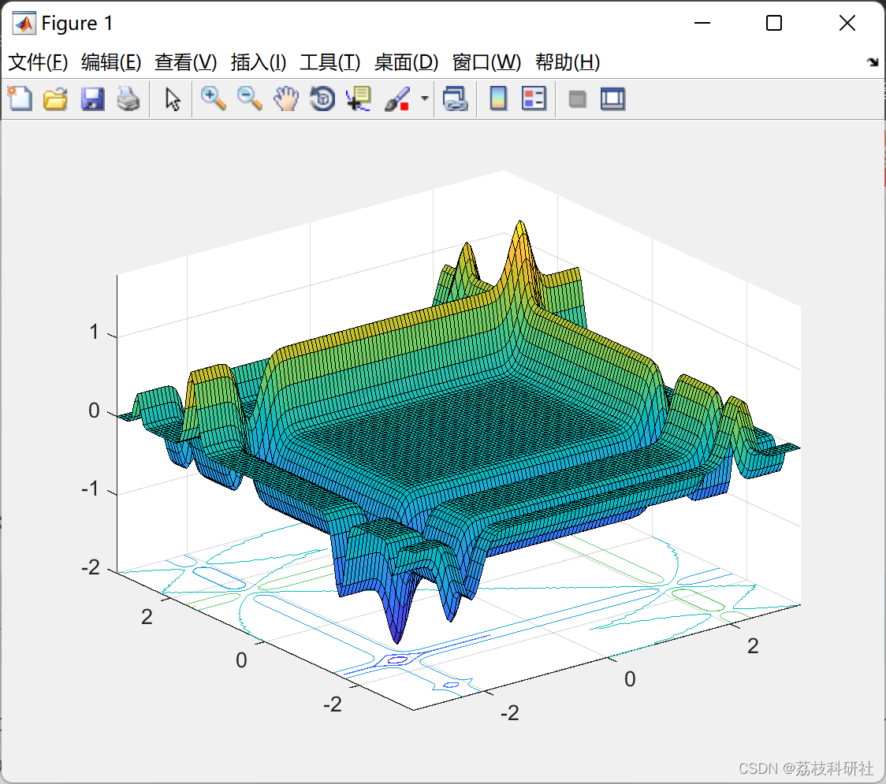
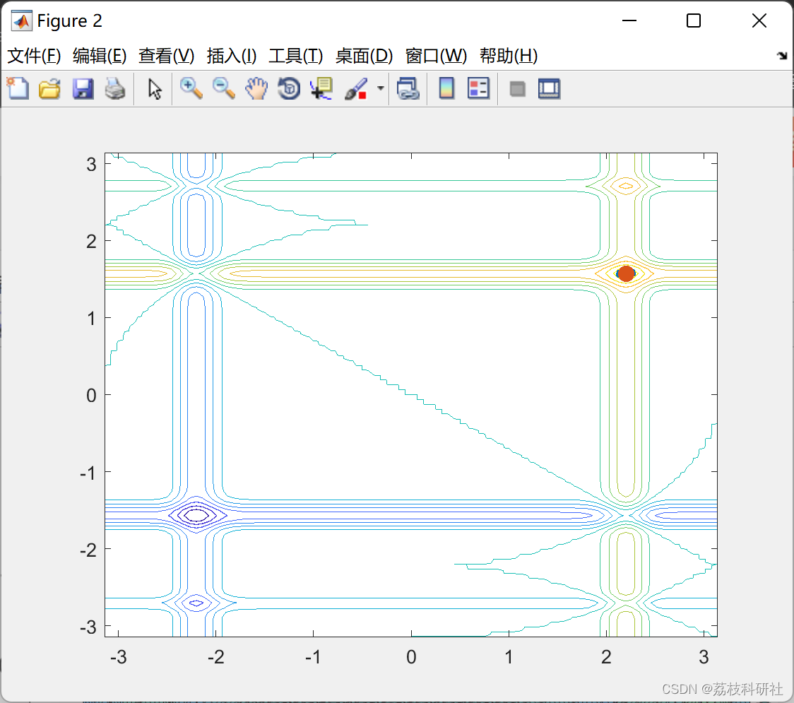

# Improved Grasshopper Optimization Algorithm (Matlab Code Implementation)

2. Running Results
Edit
Part of the code:
%Parameters
Esc=0.1;
n=2;
N=60;
p1=1.6;
Probability = zeros(N,N);
Dss = zeros(1,N);
p2=p1*5;
W=[-pi pi;-pi pi];
F1 = 0.01;
F2=F1/2;
L = 1;
F = 0.4;
L = 1.4;
% Display the function to maximize
MaxGen=100;
Ndiv=100;
dx=(range(2)-range(1))/Ndiv;
dy=(range(4)-range(3))/Ndiv;
[x,y] =meshgrid(range(1):dx:range(2),range(3):dy:range(4));
z=f(x,y);
% Display the shape of the objective function
figure(1);surfc(x,y,z);
% Initialization
xrange=range(2)-range(1);
xn=rand(N,n)*xrange+range(1);
figure(2);
% Initiate de optimization process
for gen=1:400
% Probability that defines which process would be executed
pk=1-(gen/400); % Equation 11  
%Execution of solitary phase  
if rand<=pk  
pzn=f(xn(:,1),xn(:,2));  
[Lightn,Index]=sort(pzn,'descend');  
%Check the best element of the population for calculation  
% Eq. 13  
if gen==1  
best=pzn(Index(1));  
worst=pzn(Index(N));  
else  
if best<pzn(Index(1))  
best=pzn(Index(1));  
end  
if worst>pzn(Index(N));  
worst=pzn(Index(N));  
end  
end  
Vs=zeros(N,N,n);  
Pts=zeros(N,n);  
for p=1:N  
for q=1:N  
if p~=q  
%Compute dominance Eq (4)  
if Index(p)<=Index(q)  
dom=exp(-Index(p)/N);  
else  
dom=exp(-Index(q)/N);  
end  
Ip=xn(p,:);  
Iq=xn(q,:);  
rpq=norm(Ip-Iq);  
spq=F*exp(-rpq/L)-exp(-rpq); %Equation 3  
dpq=(Iq-Ip)/(rpq+eps);  
VA=dpq*dom*spq+0.01*(2*rand(1,n)-1); % Eq. 2  
Vs(p,q,:)=VA;  
end  
end  
end  
for p=1:N  
for dim=1:n  
%Eq. 5  
Pts(p,dim)=xn(p,dim)+Esc*sum(Vs(p,:,dim));  
end  
end  
Pts(Index(1),:)=xn(Index(1),:);  
Pts=findrange(Pts,W, n);  
xn=Pts;  
else  
%Execution of social phase  
pzn=f(xn(:,1),xn(:,2));  
[Lightn,Index]=sort(pzn,'descend');  
if gen==1  
best=pzn(Index(1));  
worst=pzn(Index(N));  
else  
if best<pzn(Index(1))  
best=pzn(Index(1));  
end  
if worst>pzn(Index(N));  
worst=pzn(Index(N));  
end  
end  
for i=1:N  
for b=1:N/2  
Ii=xn(i,:);  
Ib=xn(Index(b),:);  
dis=norm(Ii-Ib);  
tem=(pzn(Index(b))-worst)/(best-worst+eps); %Eq. 13  
Dss(b)= tem*exp(-dis); %Eq. 12  
end  
% It is obtained the element I with the high probability  
[M,I] = max(Dss/sum(Dss));  
%Eq. 14  
Xn(i,:)=xn(i,:)+0.8*(xn(Index(I),:)-xn(i,:))+0.01*(2*rand(1,n)-1);  
end  
Xn(Index(1),:)=xn(Index(1),:);  
Xn=findrange(Xn,W, n);  
xn=Xn;  
🌈3 Matlab code implementation
🎉4 References
​  

## Images

<!-- PAYMENT_BLOCK -->

## Get this dataset

- Payment link (Stripe): [Buy now](https://buy.stripe.com/3cs8yP7sY87d0vu9AB)
- Payment QR code: 

<!-- /PAYMENT_BLOCK -->
